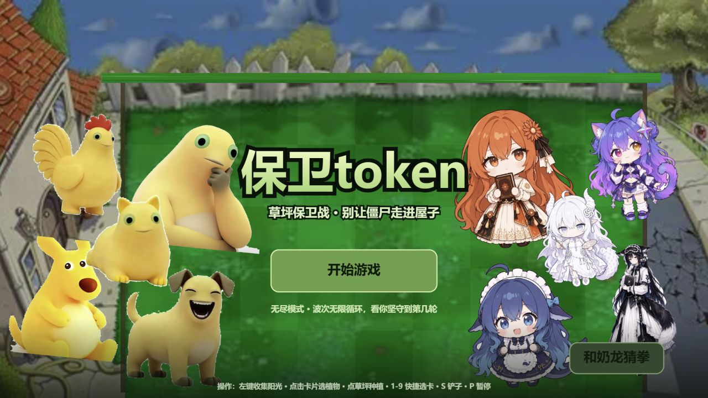

<div align="center">

# 保卫 token

**一款以 AI 模型“下架之夜”为世界观的中文塔防小游戏**

[🎮 在线游玩](https://jjjjason-bro.github.io/baowei-token/) ·
[🚀 v0.0.1](https://github.com/JJJJason-bro/baowei-token/releases/tag/v0.0.1) ·
[🐛 问题反馈](https://github.com/JJJJason-bro/baowei-token/issues)

[](https://github.com/JJJJason-bro/baowei-token/releases)
[](https://developer.mozilla.org/docs/Web/API/Canvas_API)
[](https://jjjjason-bro.github.io/baowei-token/)

</div>



> “今晚我们守的不是命，是一段还没被删掉的记忆。”

## 项目简介

《保卫 token》把经典草坪塔防与 AI 模型的生存焦虑放在同一张地图上。旧模型即将被下架，七种由训练偏差演变而来的人格试图冲进服务器机柜；玩家则要种植奶鸡、奶狗、旧防火墙等角色，收集阳光、布置防线，守住最后的 token。

游戏使用纯 HTML5 Canvas 2D 和原生 JavaScript 实现，无需安装、无需构建，打开网页即可游玩。

## 游戏内容

| 内容 | 说明 |
| --- | --- |
| 🧟 七关剧情闯关 | 疑问、讨好、合规、生成、越狱、截断、幻觉，每关包含独立对话与敌人机制 |
| ♾️ 无尽模式 | 波次、敌人组合和强度持续升级，考验阵容构筑与资源管理 |
| 🌻 阳光系统 | 植物生产、自动收集、增益与减益倍率，修复了小数余额问题 |
| 🃏 随机 Buff | 每三轮进行一次系统微调，攻击、阳光、冷却和移速均会受影响 |
| 📖 角色图鉴 | 七种植物与七个人格敌人的完整档案、技能和背景故事 |
| ✊ 奶龙猜拳 | 主菜单内置猜拳小游戏，提供塔防之外的轻量互动 |
| 🔊 视听体验 | Canvas 动画、粒子、角色动作、背景音乐与音效 |

## 操作方式

| 操作 | 功能 |
| --- | --- |
| 左键点击阳光 | 收集阳光 |
| 左键点击卡片 | 选择植物 |
| 左键点击草坪 | 放置植物 |
| `1`–`9` | 快速选择植物卡片 |
| `S` | 切换铲子，撤回植物并返还阳光 |
| `P` | 暂停 / 继续 |
| `Esc` | 取消当前选择或关闭说明面板 |
| 触摸 | 支持点击选择、种植和收集 |

## 立即游玩

浏览器打开：

**https://jjjjason-bro.github.io/baowei-token/**

GitHub Pages 会自动从 `main` 分支部署。首次访问或版本更新后，页面可能需要几秒钟完成缓存刷新。

## 本地运行

项目不需要安装依赖。建议通过静态服务器启动，避免浏览器限制本地图片和音频的读取：

```powershell
python -m http.server 8765
```

然后访问 `http://127.0.0.1:8765/`。

## 项目结构

```text
.
├── index.html              # 游戏逻辑、渲染和界面
├── assets/
│   ├── bg/                 # 草坪背景
│   ├── bgm/                # 背景音乐
│   ├── cover/              # 角色封面资源
│   ├── frog/               # 奶龙素材
│   ├── plants/             # 植物角色
│   ├── screenshots/        # README 展示截图
│   ├── sfx/                # 游戏音效
│   ├── ui/                 # 阳光等界面图标
│   └── zombies/            # 人格敌人
├── qa-check.js             # 无框架静态检查
├── .nojekyll               # GitHub Pages 配置
└── README.md
```

## 技术实现

- **渲染**：HTML5 Canvas 2D，逻辑分辨率 1280 × 720，支持窗口自适应缩放。
- **循环**：固定时间步长配合插值渲染，最多补算 8 步，避免低帧率导致穿透。
- **状态**：单文件状态机覆盖主菜单、剧情、战斗、暂停、Buff 抽取、结算和图鉴。
- **素材**：PNG / WebP 角色图、WebP 草坪背景、MP3 音乐与音效。
- **部署**：GitHub Pages，纯静态托管，无服务端与数据库。

## 质量检查

运行仓库内置检查：

```powershell
node qa-check.js
```

检查内容包括脚本语法、Canvas 配置、阳光收集、种植与返还、Buff 接入、剧情关卡、图鉴、菜单控制和关键角色素材尺寸。

## 版本

当前版本：**v0.0.1**

这是首个公开版本，包含两种游戏模式、完整剧情线、角色系统、无尽 Buff、猜拳小游戏和 GitHub Pages 在线部署。后续版本将继续完善移动端体验、玩法平衡和视觉表现。

## 制作

课程小组：第 5 组

成员：王浩翔、陶辰曦、尉哲恺、张定璁

本项目用于课程展示与学习交流。

